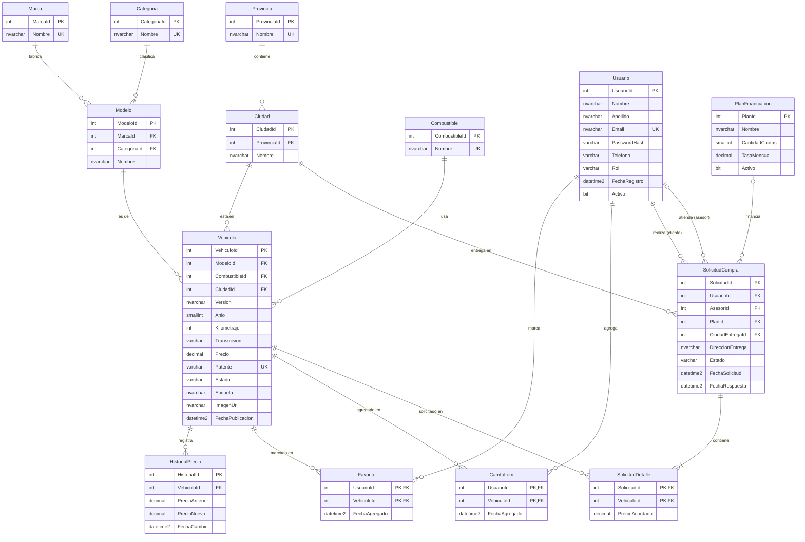
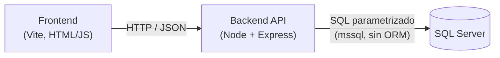
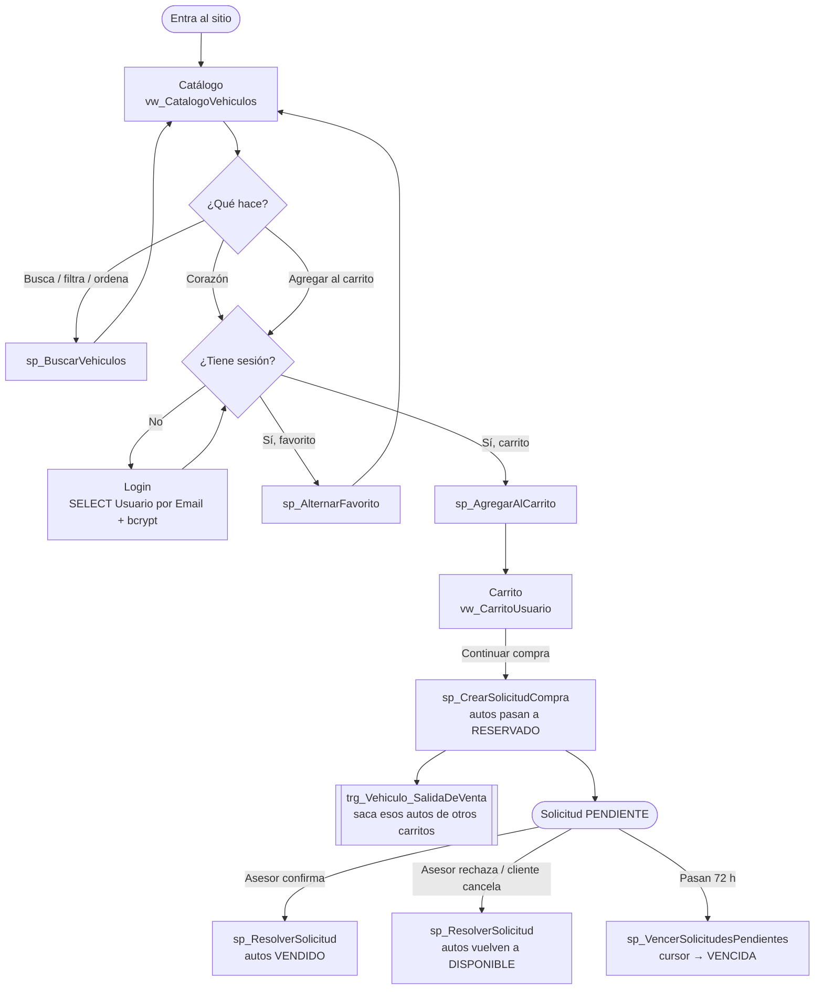
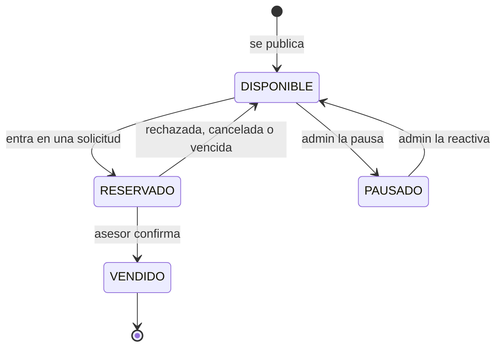
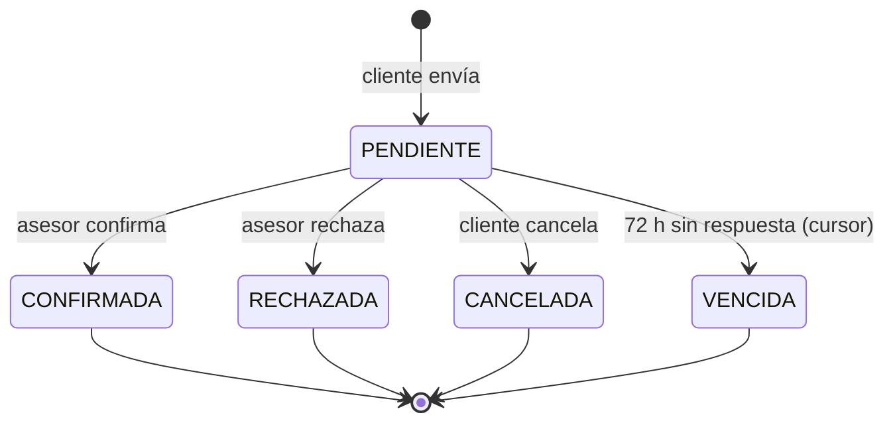

# Modelo de datos — Ruta (marketplace de autos usados)

Documento de estudio del modelamiento de la base de datos y del flujo de la aplicación.
Motor: **SQL Server**. Acceso desde el backend (Node + `mssql`) con **SQL explícito y parametrizado, sin ORM**.

> Para ver los diagramas (bloques `mermaid`): en GitHub se ven solos; en VS Code instala la extensión
> *Markdown Preview Mermaid Support* y abre la vista previa (`Ctrl+Shift+V`).

---

## Índice

1. [Qué tiene que hacer la aplicación (requisitos)](#1-qué-tiene-que-hacer-la-aplicación-requisitos)
2. [De los requisitos a las entidades](#2-de-los-requisitos-a-las-entidades)
3. [Modelo conceptual: relaciones y cardinalidades](#3-modelo-conceptual-relaciones-y-cardinalidades)
4. [Diagrama entidad-relación](#4-diagrama-entidad-relación)
5. [Diccionario de datos](#5-diccionario-de-datos)
6. [Decisiones de diseño (el porqué)](#6-decisiones-de-diseño-el-porqué)
7. [Integridad: resumen de restricciones](#7-integridad-resumen-de-restricciones)
8. [Flujo de la aplicación](#8-flujo-de-la-aplicación)
9. [Ciclo de vida (estados)](#9-ciclo-de-vida-estados)
10. [Objetos SQL: vistas, función, procedimientos](#10-objetos-sql-vistas-función-procedimientos)
11. [Trigger y cursor: qué lógica y por qué](#11-trigger-y-cursor-qué-lógica-y-por-qué)
12. [Mapeo pantalla → base de datos](#12-mapeo-pantalla--base-de-datos)
13. [Ajustes que el modelo le pide a la interfaz](#13-ajustes-que-el-modelo-le-pide-a-la-interfaz)
14. [Cómo cubre esto la rúbrica](#14-cómo-cubre-esto-la-rúbrica)
15. [Preguntas probables en la presentación](#15-preguntas-probables-en-la-presentación)
16. [Glosario rápido](#16-glosario-rápido)

---

## 1. Qué tiene que hacer la aplicación (requisitos)

Ruta es una tienda online de autos usados revisados. Un cliente navega el catálogo, filtra, guarda
favoritos, arma un carrito y envía una **solicitud de compra**. Un **asesor** revisa la solicitud y
confirma el precio final (la compra no se paga en línea).

| # | Requisito funcional | Quién |
|---|---|---|
| RF1 | Ver el catálogo de autos disponibles con foto, marca, modelo, versión, año, km, transmisión, combustible, precio, cuota y ubicación | Cualquiera |
| RF2 | Buscar por marca, modelo o versión | Cualquiera |
| RF3 | Filtrar por tipo de vehículo (SUV, Sedán, Pick-up…), rango de precio y año; ver cuántos autos hay por tipo | Cualquiera |
| RF4 | Ordenar por recomendados, menor precio, mayor precio o más nuevos | Cualquiera |
| RF5 | Iniciar sesión con correo y contraseña | Cliente |
| RF6 | Marcar autos como favoritos | Cliente |
| RF7 | Agregar autos al carrito, quitarlos y ver el subtotal | Cliente |
| RF8 | Enviar una solicitud de compra (contado o con plan de cuotas) con dirección de entrega | Cliente |
| RF9 | Confirmar o rechazar solicitudes | Asesor |
| RF10 | Publicar autos y cambiar su precio; mostrar "Bajó de precio" cuando corresponda | Admin |

Reglas de negocio:

- **RN1.** Cada auto usado es **único** (tiene patente). No hay "stock" de 5 Corollas iguales.
- **RN2.** Un auto solo puede estar en una solicitud activa a la vez. Al solicitarlo queda **reservado**.
- **RN3.** El precio que vale para la solicitud es el del momento en que se envió, aunque después cambie.
- **RN4.** Solo un usuario con rol **ASESOR** puede confirmar o rechazar una solicitud.
- **RN5.** Una solicitud pendiente por más de 72 horas **vence** y el auto vuelve a estar disponible.
- **RN6.** Todo cambio de precio queda registrado (historial), sin importar desde dónde se haga.

---

## 2. De los requisitos a las entidades

Técnica clásica: subrayar los **sustantivos** de los requisitos (candidatos a entidad) y los
**verbos** (candidatos a relación). Los sustantivos que solo describen a otro se vuelven atributos.

| Sustantivo en los requisitos | ¿Entidad o atributo? | Resultado |
|---|---|---|
| auto, vehículo | Entidad | `Vehiculo` |
| marca | Entidad (se repite en muchos autos, sirve para filtrar) | `Marca` |
| modelo | Entidad (pertenece a una marca y define el tipo) | `Modelo` |
| versión | Atributo del auto (XEI, Comfortline…) | `Vehiculo.Version` |
| tipo de vehículo | Entidad catálogo | `Categoria` |
| combustible | Entidad catálogo | `Combustible` |
| transmisión | Atributo con valores fijos (CHECK) | `Vehiculo.Transmision` |
| ubicación (ciudad, provincia) | Dos entidades (3FN) | `Ciudad`, `Provincia` |
| precio, año, km, patente, foto | Atributos del auto | `Vehiculo.*` |
| cuota | **Dato calculado**, no se guarda | función `fn_CuotaMensual` |
| plan de cuotas | Entidad | `PlanFinanciacion` |
| cliente, asesor, admin | Una entidad con rol | `Usuario.Rol` |
| favorito | Relación N:M usuario–auto | `Favorito` |
| carrito | Relación N:M usuario–auto | `CarritoItem` |
| solicitud de compra | Entidad (cabecera) | `SolicitudCompra` |
| autos de la solicitud | Entidad (detalle) | `SolicitudDetalle` |
| cambio de precio | Entidad (auditoría) | `HistorialPrecio` |

Resultado: **14 tablas**, agrupadas en 4 áreas.

| Área | Tablas |
|---|---|
| Catálogo del vehículo | `Marca`, `Modelo`, `Categoria`, `Combustible`, `Vehiculo`, `HistorialPrecio` |
| Ubicación | `Provincia`, `Ciudad` |
| Usuarios e interacción | `Usuario`, `Favorito`, `CarritoItem` |
| Compra | `PlanFinanciacion`, `SolicitudCompra`, `SolicitudDetalle` |

---

## 3. Modelo conceptual: relaciones y cardinalidades

Se lee "una X tiene cero o muchas Y".

| Relación | Cardinalidad | Cómo se implementa |
|---|---|---|
| Provincia — Ciudad | 1 : N | FK `Ciudad.ProvinciaId` |
| Marca — Modelo | 1 : N | FK `Modelo.MarcaId` |
| Categoria — Modelo | 1 : N | FK `Modelo.CategoriaId` |
| Modelo — Vehiculo | 1 : N | FK `Vehiculo.ModeloId` |
| Combustible — Vehiculo | 1 : N | FK `Vehiculo.CombustibleId` |
| Ciudad — Vehiculo | 1 : N | FK `Vehiculo.CiudadId` |
| Vehiculo — HistorialPrecio | 1 : N | FK `HistorialPrecio.VehiculoId` |
| Usuario — Vehiculo (favoritos) | **N : M** | tabla intermedia `Favorito` |
| Usuario — Vehiculo (carrito) | **N : M** | tabla intermedia `CarritoItem` |
| Usuario (cliente) — SolicitudCompra | 1 : N | FK `SolicitudCompra.UsuarioId` |
| Usuario (asesor) — SolicitudCompra | 0..1 : N | FK `SolicitudCompra.AsesorId` (NULL mientras nadie la atiende) |
| PlanFinanciacion — SolicitudCompra | 0..1 : N | FK `SolicitudCompra.PlanId` (NULL = contado) |
| Ciudad — SolicitudCompra | 1 : N | FK `SolicitudCompra.CiudadEntregaId` |
| SolicitudCompra — Vehiculo | **N : M** | tabla intermedia `SolicitudDetalle` (con atributo propio `PrecioAcordado`) |

Dos cosas que suelen preguntar:

- **Usuario aparece dos veces en SolicitudCompra** (cliente y asesor). Son dos FK distintas a la misma tabla.
- **SolicitudDetalle no es una tabla intermedia "pura"**: además de las dos FK guarda `PrecioAcordado`,
  que es un dato de la relación (el precio de ese auto en esa solicitud), no del auto ni de la solicitud.

---

## 4. Diagrama entidad-relación



---

## 5. Diccionario de datos

Convenciones: PK con `INT IDENTITY(1,1)`; nombres en español y PascalCase; montos en `DECIMAL(14,2)`
(nunca `FLOAT` para dinero, porque redondea); fechas en `DATETIME2` con `DEFAULT SYSDATETIME()`.

### Provincia
| Columna | Tipo | Restricciones |
|---|---|---|
| ProvinciaId | INT IDENTITY | PK |
| Nombre | NVARCHAR(60) | NOT NULL, UNIQUE |

### Ciudad
| Columna | Tipo | Restricciones |
|---|---|---|
| CiudadId | INT IDENTITY | PK |
| ProvinciaId | INT | NOT NULL, FK → Provincia |
| Nombre | NVARCHAR(80) | NOT NULL |
| | | UNIQUE (ProvinciaId, Nombre): puede haber dos "San Martín" en provincias distintas, pero no en la misma |

### Marca
| Columna | Tipo | Restricciones |
|---|---|---|
| MarcaId | INT IDENTITY | PK |
| Nombre | NVARCHAR(50) | NOT NULL, UNIQUE |

### Categoria
Tipo de carrocería: SUV, Sedán, Pick-up, Hatchback.

| Columna | Tipo | Restricciones |
|---|---|---|
| CategoriaId | INT IDENTITY | PK |
| Nombre | NVARCHAR(40) | NOT NULL, UNIQUE |

### Modelo
| Columna | Tipo | Restricciones |
|---|---|---|
| ModeloId | INT IDENTITY | PK |
| MarcaId | INT | NOT NULL, FK → Marca |
| CategoriaId | INT | NOT NULL, FK → Categoria |
| Nombre | NVARCHAR(60) | NOT NULL |
| | | UNIQUE (MarcaId, Nombre) |

### Combustible
| Columna | Tipo | Restricciones |
|---|---|---|
| CombustibleId | INT IDENTITY | PK |
| Nombre | NVARCHAR(30) | NOT NULL, UNIQUE (Nafta, Diésel, Híbrido, Eléctrico) |

### Vehiculo
| Columna | Tipo | Restricciones |
|---|---|---|
| VehiculoId | INT IDENTITY | PK |
| ModeloId | INT | NOT NULL, FK → Modelo |
| Version | NVARCHAR(60) | NOT NULL (ej. "XEI", "Comfortline") |
| Anio | SMALLINT | NOT NULL, CHECK (Anio BETWEEN 1990 AND YEAR(GETDATE()) + 1) |
| Kilometraje | INT | NOT NULL, CHECK (Kilometraje >= 0) |
| Transmision | VARCHAR(10) | NOT NULL, CHECK IN ('MANUAL', 'AUTOMATICA') |
| CombustibleId | INT | NOT NULL, FK → Combustible |
| Precio | DECIMAL(14,2) | NOT NULL, CHECK (Precio > 0) |
| Patente | VARCHAR(10) | NOT NULL, UNIQUE |
| CiudadId | INT | NOT NULL, FK → Ciudad |
| Estado | VARCHAR(12) | NOT NULL, DEFAULT 'DISPONIBLE', CHECK IN ('DISPONIBLE','RESERVADO','VENDIDO','PAUSADO') |
| Etiqueta | NVARCHAR(40) | NULL (texto comercial: "Único dueño", "Garantía 1 año") |
| ImagenUrl | NVARCHAR(300) | NULL |
| FechaPublicacion | DATETIME2 | NOT NULL, DEFAULT SYSDATETIME() |

### HistorialPrecio
| Columna | Tipo | Restricciones |
|---|---|---|
| HistorialId | INT IDENTITY | PK |
| VehiculoId | INT | NOT NULL, FK → Vehiculo |
| PrecioAnterior | DECIMAL(14,2) | NOT NULL |
| PrecioNuevo | DECIMAL(14,2) | NOT NULL |
| FechaCambio | DATETIME2 | NOT NULL, DEFAULT SYSDATETIME() |

Esta tabla **solo la escribe el trigger** `trg_Vehiculo_CambioPrecio` (sección 11).

### Usuario
| Columna | Tipo | Restricciones |
|---|---|---|
| UsuarioId | INT IDENTITY | PK |
| Nombre | NVARCHAR(60) | NOT NULL |
| Apellido | NVARCHAR(60) | NOT NULL |
| Email | NVARCHAR(120) | NOT NULL, UNIQUE |
| PasswordHash | VARCHAR(100) | NOT NULL (hash bcrypt, **nunca** la contraseña en texto plano) |
| Telefono | VARCHAR(20) | NULL |
| Rol | VARCHAR(10) | NOT NULL, DEFAULT 'CLIENTE', CHECK IN ('CLIENTE','ASESOR','ADMIN') |
| FechaRegistro | DATETIME2 | NOT NULL, DEFAULT SYSDATETIME() |
| Activo | BIT | NOT NULL, DEFAULT 1 |

### Favorito
| Columna | Tipo | Restricciones |
|---|---|---|
| UsuarioId | INT | PK compuesta, FK → Usuario (ON DELETE CASCADE) |
| VehiculoId | INT | PK compuesta, FK → Vehiculo |
| FechaAgregado | DATETIME2 | NOT NULL, DEFAULT SYSDATETIME() |

La PK compuesta (UsuarioId, VehiculoId) impide marcar dos veces el mismo auto.

### CarritoItem
Misma estructura que `Favorito`. **No tiene columna cantidad** (ver RN1 y sección 6).

### PlanFinanciacion
| Columna | Tipo | Restricciones |
|---|---|---|
| PlanId | INT IDENTITY | PK |
| Nombre | NVARCHAR(50) | NOT NULL (ej. "48 cuotas") |
| CantidadCuotas | SMALLINT | NOT NULL, CHECK (CantidadCuotas > 0) |
| TasaMensual | DECIMAL(6,4) | NOT NULL, CHECK (TasaMensual >= 0) (0.0240 = 2,4 % mensual) |
| Activo | BIT | NOT NULL, DEFAULT 1 |

Con 48 cuotas y 2,4 % mensual, un auto de $28.900.000 da cuotas de ~$1.020.000, que es justo lo que
muestra la tarjeta del Toyota en la interfaz.

### SolicitudCompra
| Columna | Tipo | Restricciones |
|---|---|---|
| SolicitudId | INT IDENTITY | PK |
| UsuarioId | INT | NOT NULL, FK → Usuario (el cliente) |
| AsesorId | INT | NULL, FK → Usuario (el asesor que la resuelve) |
| PlanId | INT | NULL, FK → PlanFinanciacion (NULL = contado) |
| CiudadEntregaId | INT | NOT NULL, FK → Ciudad |
| DireccionEntrega | NVARCHAR(200) | NOT NULL |
| Estado | VARCHAR(12) | NOT NULL, DEFAULT 'PENDIENTE', CHECK IN ('PENDIENTE','CONFIRMADA','RECHAZADA','CANCELADA','VENCIDA') |
| FechaSolicitud | DATETIME2 | NOT NULL, DEFAULT SYSDATETIME() |
| FechaRespuesta | DATETIME2 | NULL |
| | | CHECK (AsesorId IS NULL OR AsesorId <> UsuarioId): nadie se atiende a sí mismo |

No tiene columna `Total`: el total es la suma de los detalles y se calcula en la vista
`vw_SolicitudesResumen`. Guardarlo sería redundante (podría quedar desalineado con los detalles).

### SolicitudDetalle
| Columna | Tipo | Restricciones |
|---|---|---|
| SolicitudId | INT | PK compuesta, FK → SolicitudCompra |
| VehiculoId | INT | PK compuesta, FK → Vehiculo |
| PrecioAcordado | DECIMAL(14,2) | NOT NULL, CHECK (PrecioAcordado > 0) |

---

## 6. Decisiones de diseño (el porqué)

**Normalización hasta 3FN.**
- *1FN*: todos los campos son atómicos. La ubicación "Palermo, Buenos Aires" no se guarda como un
  texto, se separa en Ciudad y Provincia.
- *2FN*: en las tablas con PK compuesta (`Favorito`, `CarritoItem`, `SolicitudDetalle`) cada atributo
  depende de la clave completa. `PrecioAcordado` depende del par (solicitud, auto), no solo de uno.
- *3FN*: no hay dependencias transitivas. La provincia depende de la ciudad, no del auto; por eso
  `Vehiculo` solo guarda `CiudadId`. La categoría depende del modelo (un Corolla Cross siempre es
  SUV), por eso está en `Modelo` y no en `Vehiculo`.

**Marca y Modelo separados de Vehiculo.** Si "Toyota" fuera un texto en cada auto, alguien escribe
"toyota" o "Toyta" y el filtro por marca falla. Con tablas catálogo y FK, el valor existe una sola vez.

**Transmisión con CHECK y Combustible con tabla.** Transmisión tiene dos valores que no van a
cambiar, así que basta un CHECK. Combustible es un filtro de la interfaz (ej. "Eléctricos") y puede
crecer (GNC, híbrido enchufable), así que conviene una tabla.

**El carrito no tiene cantidad.** Cada auto usado es único (RN1). Una columna `Cantidad` permitiría
pedir 3 unidades de un auto que existe una vez. La PK (UsuarioId, VehiculoId) garantiza que cada auto
aparezca una sola vez por carrito.

**La cuota no se guarda.** "48 cuotas de $1.020.000" depende del precio y del plan. Si se guardara y
después cambia el precio, la cuota quedaría mal. Se calcula con `fn_CuotaMensual` en la vista.

**`PrecioAcordado` sí se guarda, aunque parezca repetido.** No es redundancia: es una foto del
precio en el momento de la solicitud (RN3). Si mañana el admin baja el precio, la solicitud de ayer
mantiene el precio con el que se pidió.

**Rol como columna, no como tabla.** Hay tres roles fijos y ninguno tiene atributos propios. Un CHECK
es suficiente. Si en el futuro los permisos fueran configurables, se pasaría a tablas `Rol` y
`Permiso`.

**"El asesor tiene que tener rol ASESOR" no se puede hacer con CHECK.** Un CHECK solo mira la fila
actual; no puede consultar otra tabla. Esa regla (RN4) se valida dentro de `sp_ResolverSolicitud`.

**Los autos no se borran.** Un auto vendido aparece en solicitudes históricas; borrarlo rompería las
FK. Se usa `Estado = 'PAUSADO'` o `'VENDIDO'` (borrado lógico).

---

## 7. Integridad: resumen de restricciones

| Tipo | Dónde | Qué protege |
|---|---|---|
| PRIMARY KEY | Todas las tablas | Cada fila se identifica de forma única |
| PK compuesta | Favorito, CarritoItem, SolicitudDetalle | Sin duplicados (mismo auto dos veces) |
| FOREIGN KEY | 17 relaciones | No hay autos de un modelo inexistente, ni solicitudes de usuarios inexistentes |
| UNIQUE | Email, Patente, nombres de catálogo, (MarcaId, Nombre), (ProvinciaId, Nombre) | Un correo por cuenta, una patente por auto |
| CHECK | Precio > 0, Kilometraje ≥ 0, rango de Anio, Estado, Rol, Transmision, cuotas > 0, tasa ≥ 0, asesor ≠ cliente | Valores imposibles no entran a la tabla |
| DEFAULT | Fechas, Estado, Rol, Activo | Valores consistentes sin depender del backend |
| ON DELETE CASCADE | Favorito y CarritoItem → Usuario | Si se elimina un usuario, se van sus favoritos y carrito |
| NO ACTION (por defecto) | Todo lo demás | No se puede borrar un auto que está en una solicitud |
| Trigger | Vehiculo | Historial de precios y limpieza de carritos (sección 11) |
| Validación en SP | sp_CrearSolicitudCompra, sp_ResolverSolicitud | Reglas que cruzan tablas (RN2, RN4) |

Hay tres niveles de defensa y conviene saber explicarlos:
1. **Frontend**: valida para dar buena experiencia (no es seguridad, se puede saltar).
2. **Backend**: valida tipos y formatos antes de llamar a la base, y siempre usa parámetros.
3. **Base de datos**: restricciones y SP. Es la última barrera y la única que no se puede saltar.

---

## 8. Flujo de la aplicación

### Arquitectura



El frontend **nunca** habla con SQL Server. Todo pasa por la API, que es la única que tiene las
credenciales de la base.

### Recorrido del usuario



### Pantalla, endpoint y objeto SQL

| Paso | Acción en la interfaz | Endpoint | Objeto SQL |
|---|---|---|---|
| 1 | Carga el catálogo | `GET /api/vehiculos` | `sp_BuscarVehiculos` (lee `vw_CatalogoVehiculos`) |
| 2 | Carga filtros y conteos ("SUV 6") | `GET /api/categorias` | `vw_ConteoPorCategoria` |
| 3 | Busca, filtra u ordena | `GET /api/vehiculos?texto=&categoriaId=&precioMin=&precioMax=&anioMin=&anioMax=&orden=` | `sp_BuscarVehiculos` |
| 4 | Inicia sesión | `POST /api/auth/login` | `SELECT … FROM Usuario WHERE Email = @Email` + bcrypt en el backend |
| 5 | Marca o desmarca favorito | `POST /api/favoritos/:vehiculoId` | `sp_AlternarFavorito` |
| 6 | Agrega al carrito | `POST /api/carrito` | `sp_AgregarAlCarrito` |
| 7 | Abre el carrito | `GET /api/carrito` | `vw_CarritoUsuario` |
| 8 | Quita un auto del carrito | `DELETE /api/carrito/:vehiculoId` | `DELETE` parametrizado |
| 9 | Elige plan de cuotas | `GET /api/planes` | `SELECT` de planes activos |
| 10 | Continuar compra | `POST /api/solicitudes` | `sp_CrearSolicitudCompra` (dispara el trigger de limpieza) |
| 11 | Asesor ve solicitudes | `GET /api/solicitudes` | `vw_SolicitudesResumen` |
| 12 | Asesor confirma o rechaza | `PATCH /api/solicitudes/:id` | `sp_ResolverSolicitud` |
| 13 | Admin cambia un precio | `PATCH /api/vehiculos/:id/precio` | `UPDATE Vehiculo` (dispara `trg_Vehiculo_CambioPrecio`) |
| 14 | Tarea programada | (backend, cada hora) | `sp_VencerSolicitudesPendientes` (cursor) |

### Por qué el login no compara la contraseña en SQL

El hash bcrypt incluye una "sal" aleatoria, así que el mismo password da hashes distintos y no se
puede hacer `WHERE PasswordHash = @hash`. El backend trae el hash por email (consulta parametrizada) y
lo compara con `bcrypt.compare`. La contraseña nunca viaja a la base.

---

## 9. Ciclo de vida (estados)

### Vehiculo.Estado



### SolicitudCompra.Estado



Solo se sale de PENDIENTE. Una solicitud confirmada no puede volver atrás; eso lo valida
`sp_ResolverSolicitud`.

---

## 10. Objetos SQL: vistas, función, procedimientos

### Función `fn_CuotaMensual`

Calcula la cuota con el sistema francés (cuota fija):

`cuota = P · i / (1 − (1 + i)^(−n))`, con P = precio, i = tasa mensual, n = cantidad de cuotas.
Si la tasa es 0, la cuota es `P / n`.

```sql
CREATE OR ALTER FUNCTION dbo.fn_CuotaMensual
    (@Precio DECIMAL(14,2), @Cuotas SMALLINT, @Tasa DECIMAL(6,4))
RETURNS DECIMAL(14,2)
AS
BEGIN
    IF @Cuotas IS NULL OR @Cuotas <= 0 RETURN NULL;
    IF @Tasa = 0 RETURN @Precio / @Cuotas;
    RETURN @Precio * @Tasa / (1 - POWER(CAST(1 + @Tasa AS FLOAT), -@Cuotas));
END;
```

### Vistas

Cada vista resuelve una necesidad concreta de una pantalla. Ninguna es copia de una tabla.

| Vista | Para qué pantalla | Qué hace |
|---|---|---|
| `vw_CatalogoVehiculos` | Grilla del catálogo | JOIN de 7 tablas, solo autos DISPONIBLE, arma "Ciudad, Provincia", calcula la cuota con el plan más largo y la marca `BajoDePrecio` (subconsulta sobre HistorialPrecio de los últimos 30 días) |
| `vw_ConteoPorCategoria` | Filtro "Tipo de vehículo" | `LEFT JOIN` + `GROUP BY` + `COUNT`: cuántos autos disponibles hay por categoría, incluidas las que tienen 0 |
| `vw_CarritoUsuario` | Cajón del carrito | Autos del carrito con marca, modelo, precio, foto y si siguen disponibles |
| `vw_SolicitudesResumen` | Panel del asesor | Solicitud + cliente + plan + cantidad de autos + total (`SUM(PrecioAcordado)`) |

```sql
CREATE OR ALTER VIEW dbo.vw_CatalogoVehiculos
AS
SELECT
    v.VehiculoId, ma.Nombre AS Marca, mo.Nombre AS Modelo, v.Version,
    c.CategoriaId, c.Nombre AS Categoria,
    v.Anio, v.Kilometraje, v.Transmision, co.Nombre AS Combustible,
    v.Precio, pl.CantidadCuotas,
    dbo.fn_CuotaMensual(v.Precio, pl.CantidadCuotas, pl.TasaMensual) AS CuotaMensual,
    ci.Nombre + N', ' + pr.Nombre AS Ubicacion,
    v.Etiqueta, v.ImagenUrl, v.FechaPublicacion,
    CASE WHEN EXISTS (
        SELECT 1 FROM dbo.HistorialPrecio h
        WHERE h.VehiculoId = v.VehiculoId
          AND h.PrecioNuevo < h.PrecioAnterior
          AND h.FechaCambio >= DATEADD(DAY, -30, SYSDATETIME())
    ) THEN 1 ELSE 0 END AS BajoDePrecio
FROM dbo.Vehiculo v
JOIN dbo.Modelo mo      ON mo.ModeloId = v.ModeloId
JOIN dbo.Marca ma       ON ma.MarcaId = mo.MarcaId
JOIN dbo.Categoria c    ON c.CategoriaId = mo.CategoriaId
JOIN dbo.Combustible co ON co.CombustibleId = v.CombustibleId
JOIN dbo.Ciudad ci      ON ci.CiudadId = v.CiudadId
JOIN dbo.Provincia pr   ON pr.ProvinciaId = ci.ProvinciaId
OUTER APPLY (
    SELECT TOP 1 CantidadCuotas, TasaMensual
    FROM dbo.PlanFinanciacion
    WHERE Activo = 1
    ORDER BY CantidadCuotas DESC
) pl
WHERE v.Estado = 'DISPONIBLE';
```

```sql
CREATE OR ALTER VIEW dbo.vw_ConteoPorCategoria
AS
SELECT c.CategoriaId, c.Nombre, COUNT(v.VehiculoId) AS Disponibles
FROM dbo.Categoria c
LEFT JOIN dbo.Modelo mo   ON mo.CategoriaId = c.CategoriaId
LEFT JOIN dbo.Vehiculo v  ON v.ModeloId = mo.ModeloId AND v.Estado = 'DISPONIBLE'
GROUP BY c.CategoriaId, c.Nombre;
```

Detalle de examen: el filtro `v.Estado = 'DISPONIBLE'` va en el `ON` y no en un `WHERE`. Si fuera
en el `WHERE`, las categorías sin autos desaparecerían (el `WHERE` descarta las filas con NULL que
genera el `LEFT JOIN`).

### Procedimientos almacenados

| SP | Parámetros | Valida | Hace |
|---|---|---|---|
| `sp_BuscarVehiculos` | @Texto, @CategoriaId, @PrecioMin, @PrecioMax, @AnioMin, @AnioMax, @Orden | PrecioMin ≤ PrecioMax, AnioMin ≤ AnioMax, @Orden válido | SELECT sobre `vw_CatalogoVehiculos` con filtros opcionales y ORDER BY dinámico con CASE |
| `sp_AgregarAlCarrito` | @UsuarioId, @VehiculoId | Auto existe y está DISPONIBLE; no está ya en el carrito | INSERT en CarritoItem |
| `sp_AlternarFavorito` | @UsuarioId, @VehiculoId | Auto existe | Si existe lo borra, si no lo inserta; devuelve el estado final |
| `sp_CrearSolicitudCompra` | @UsuarioId, @PlanId, @CiudadEntregaId, @DireccionEntrega | Carrito no vacío, plan activo, todos los autos DISPONIBLE | **Transacción**: cabecera + detalles con precio actual + autos a RESERVADO + vacía el carrito |
| `sp_ResolverSolicitud` | @SolicitudId, @AsesorId, @NuevoEstado | Solicitud PENDIENTE; estado destino válido; si confirma/rechaza, @AsesorId debe tener rol ASESOR | **Transacción**: cambia estado de la solicitud y de sus autos (VENDIDO o DISPONIBLE) |
| `sp_VencerSolicitudesPendientes` | @Horas = 72 | — | Cursor que llama a `sp_ResolverSolicitud` por cada solicitud vencida (sección 11) |

Los errores de negocio se lanzan con `THROW 50xxx, 'mensaje', 1`. El backend reconoce los códigos
50000–50999 y responde **400/409 con el mensaje**; cualquier otro error responde 500 sin detalles.

#### `sp_BuscarVehiculos` (filtros opcionales sin SQL dinámico)

```sql
CREATE OR ALTER PROCEDURE dbo.sp_BuscarVehiculos
    @Texto       NVARCHAR(60)  = NULL,
    @CategoriaId INT           = NULL,
    @PrecioMin   DECIMAL(14,2) = NULL,
    @PrecioMax   DECIMAL(14,2) = NULL,
    @AnioMin     SMALLINT      = NULL,
    @AnioMax     SMALLINT      = NULL,
    @Orden       VARCHAR(12)   = 'recomendados'
AS
BEGIN
    SET NOCOUNT ON;

    IF @PrecioMin > @PrecioMax THROW 50001, 'El precio mínimo no puede ser mayor que el máximo.', 1;
    IF @AnioMin > @AnioMax     THROW 50002, 'El año mínimo no puede ser mayor que el máximo.', 1;
    IF @Orden NOT IN ('recomendados', 'precio_asc', 'precio_desc', 'anio')
        THROW 50003, 'Orden no válido.', 1;

    SELECT *
    FROM dbo.vw_CatalogoVehiculos
    WHERE (@Texto IS NULL OR Marca + N' ' + Modelo + N' ' + Version LIKE N'%' + @Texto + N'%')
      AND (@CategoriaId IS NULL OR CategoriaId = @CategoriaId)
      AND (@PrecioMin  IS NULL OR Precio >= @PrecioMin)
      AND (@PrecioMax  IS NULL OR Precio <= @PrecioMax)
      AND (@AnioMin    IS NULL OR Anio   >= @AnioMin)
      AND (@AnioMax    IS NULL OR Anio   <= @AnioMax)
    ORDER BY
        CASE WHEN @Orden = 'precio_asc'  THEN Precio END ASC,
        CASE WHEN @Orden = 'precio_desc' THEN Precio END DESC,
        CASE WHEN @Orden = 'anio'        THEN Anio   END DESC,
        FechaPublicacion DESC;
END;
```

¿El `LIKE N'%' + @Texto + N'%'` es inyección SQL? **No.** Se concatena el *valor* del parámetro
dentro de la expresión, no se arma un texto de consulta para ejecutar. Inyección habría con
`EXEC('SELECT … LIKE ''%' + @Texto + '%''')`.

#### `sp_CrearSolicitudCompra` (el SP central)

```sql
CREATE OR ALTER PROCEDURE dbo.sp_CrearSolicitudCompra
    @UsuarioId        INT,
    @PlanId           INT = NULL,
    @CiudadEntregaId  INT,
    @DireccionEntrega NVARCHAR(200)
AS
BEGIN
    SET NOCOUNT ON;
    SET XACT_ABORT ON;  -- ante cualquier error, la transacción se revierte entera

    IF NULLIF(LTRIM(RTRIM(@DireccionEntrega)), N'') IS NULL
        THROW 50010, 'La dirección de entrega es obligatoria.', 1;
    IF @PlanId IS NOT NULL AND NOT EXISTS
        (SELECT 1 FROM dbo.PlanFinanciacion WHERE PlanId = @PlanId AND Activo = 1)
        THROW 50011, 'El plan de financiación no existe o no está activo.', 1;

    BEGIN TRY
        BEGIN TRANSACTION;

        IF NOT EXISTS (SELECT 1 FROM dbo.CarritoItem WHERE UsuarioId = @UsuarioId)
            THROW 50012, 'El carrito está vacío.', 1;

        -- UPDLOCK bloquea esos autos hasta el COMMIT: si dos clientes compran
        -- el mismo auto al mismo tiempo, el segundo espera y luego falla aquí.
        IF EXISTS (
            SELECT 1
            FROM dbo.CarritoItem ci
            JOIN dbo.Vehiculo v WITH (UPDLOCK, HOLDLOCK) ON v.VehiculoId = ci.VehiculoId
            WHERE ci.UsuarioId = @UsuarioId AND v.Estado <> 'DISPONIBLE'
        )
            THROW 50013, 'Uno o más autos del carrito ya no están disponibles.', 1;

        INSERT INTO dbo.SolicitudCompra (UsuarioId, PlanId, CiudadEntregaId, DireccionEntrega)
        VALUES (@UsuarioId, @PlanId, @CiudadEntregaId, LTRIM(RTRIM(@DireccionEntrega)));

        DECLARE @SolicitudId INT = SCOPE_IDENTITY();

        INSERT INTO dbo.SolicitudDetalle (SolicitudId, VehiculoId, PrecioAcordado)
        SELECT @SolicitudId, v.VehiculoId, v.Precio
        FROM dbo.CarritoItem ci
        JOIN dbo.Vehiculo v ON v.VehiculoId = ci.VehiculoId
        WHERE ci.UsuarioId = @UsuarioId;

        UPDATE v SET Estado = 'RESERVADO'
        FROM dbo.Vehiculo v
        JOIN dbo.CarritoItem ci ON ci.VehiculoId = v.VehiculoId
        WHERE ci.UsuarioId = @UsuarioId;

        DELETE FROM dbo.CarritoItem WHERE UsuarioId = @UsuarioId;

        COMMIT TRANSACTION;
        SELECT @SolicitudId AS SolicitudId;
    END TRY
    BEGIN CATCH
        IF @@TRANCOUNT > 0 ROLLBACK TRANSACTION;
        THROW;  -- re-lanza el error original al backend
    END CATCH
END;
```

Por qué es una transacción: son 4 operaciones (insertar cabecera, insertar detalles, reservar autos,
vaciar carrito). Si falla la tercera, sin transacción quedaría una solicitud sin autos reservados.
Con transacción, o se hacen las 4 o ninguna (**atomicidad**, la A de ACID).

---

## 11. Trigger y cursor: qué lógica y por qué

### Trigger 1: `trg_Vehiculo_CambioPrecio` (historial de precios)

**Qué hace:** cada vez que cambia `Vehiculo.Precio`, inserta una fila en `HistorialPrecio` con el
precio anterior y el nuevo.

**Por qué trigger y no SP:** el precio se puede cambiar desde un SP, desde el panel admin, desde un
script de carga o a mano en Management Studio. Si el registro dependiera de que cada uno se acuerde
de llamar al SP, tarde o temprano se pierde un cambio. El trigger se ejecuta **siempre**, sin
importar el origen (RN6). Además alimenta la etiqueta "Bajó de precio" de la interfaz.

```sql
CREATE OR ALTER TRIGGER dbo.trg_Vehiculo_CambioPrecio
ON dbo.Vehiculo
AFTER UPDATE
AS
BEGIN
    SET NOCOUNT ON;
    IF NOT UPDATE(Precio) RETURN;

    INSERT INTO dbo.HistorialPrecio (VehiculoId, PrecioAnterior, PrecioNuevo)
    SELECT d.VehiculoId, d.Precio, i.Precio
    FROM inserted i
    JOIN deleted d ON d.VehiculoId = i.VehiculoId
    WHERE i.Precio <> d.Precio;
END;
```

Claves para explicarlo:
- `deleted` tiene las filas **antes** del UPDATE e `inserted` las filas **después**.
- Se hace con JOIN y no con variables (`SELECT @precio = Precio FROM inserted`) porque un UPDATE
  puede tocar muchas filas a la vez ("bajar 5 % todos los SUV") y el trigger se dispara **una vez
  por sentencia**, no una vez por fila.
- `WHERE i.Precio <> d.Precio` evita registrar "cambios" donde se reescribió el mismo valor.

### Trigger 2: `trg_Vehiculo_SalidaDeVenta` (limpieza de carritos)

**Qué hace:** cuando un auto pasa de DISPONIBLE a otro estado (RESERVADO, VENDIDO, PAUSADO), lo saca
de todos los carritos.

**Por qué trigger:** un auto deja de estar disponible por varios caminos (lo compra otro cliente, el
admin lo pausa). Con el trigger, ningún cliente llega al checkout con un auto que ya no se puede
comprar, sin importar qué camino lo sacó de venta. Los favoritos se mantienen a propósito: el cliente
puede querer ver si el auto vuelve.

```sql
CREATE OR ALTER TRIGGER dbo.trg_Vehiculo_SalidaDeVenta
ON dbo.Vehiculo
AFTER UPDATE
AS
BEGIN
    SET NOCOUNT ON;
    IF NOT UPDATE(Estado) RETURN;

    DELETE ci
    FROM dbo.CarritoItem ci
    JOIN inserted i ON i.VehiculoId = ci.VehiculoId
    JOIN deleted  d ON d.VehiculoId = i.VehiculoId
    WHERE d.Estado = 'DISPONIBLE' AND i.Estado <> 'DISPONIBLE';
END;
```

### Cursor: `sp_VencerSolicitudesPendientes`

**Qué hace:** recorre las solicitudes PENDIENTE con más de 72 horas y, **una por una**, llama a
`sp_ResolverSolicitud` con estado VENCIDA, que libera sus autos (RN5).

**Por qué cursor (y no un UPDATE masivo):**
1. **Reutiliza la lógica existente.** `sp_ResolverSolicitud` ya tiene todas las validaciones y la
   transacción para cambiar el estado de una solicitud y de sus autos. Un SP recibe *un*
   `@SolicitudId`; para aplicarlo a varias hay que recorrerlas. Así hay una sola fuente de verdad
   para las transiciones de estado; si mañana se agrega una regla, se agrega en un solo lugar.
2. **Aísla errores.** Cada llamada va dentro de su propio TRY/CATCH. Si una solicitud falla, se
   registra y se sigue con las demás. Con un UPDATE masivo, un error revierte todo el lote.

**Lo que hay que reconocer si preguntan:** un UPDATE basado en conjuntos sería más rápido. Se acepta
el cursor porque el volumen es bajo (decenas de solicitudes al día) y la tarea corre en segundo
plano, así que la velocidad no importa y la consistencia sí.

```sql
CREATE OR ALTER PROCEDURE dbo.sp_VencerSolicitudesPendientes
    @Horas INT = 72
AS
BEGIN
    SET NOCOUNT ON;
    DECLARE @SolicitudId INT, @Vencidas INT = 0, @Errores INT = 0;

    DECLARE cur_Vencidas CURSOR LOCAL FAST_FORWARD FOR
        SELECT SolicitudId
        FROM dbo.SolicitudCompra
        WHERE Estado = 'PENDIENTE'
          AND FechaSolicitud < DATEADD(HOUR, -@Horas, SYSDATETIME());

    OPEN cur_Vencidas;
    FETCH NEXT FROM cur_Vencidas INTO @SolicitudId;

    WHILE @@FETCH_STATUS = 0
    BEGIN
        BEGIN TRY
            EXEC dbo.sp_ResolverSolicitud
                 @SolicitudId = @SolicitudId, @AsesorId = NULL, @NuevoEstado = 'VENCIDA';
            SET @Vencidas += 1;
        END TRY
        BEGIN CATCH
            SET @Errores += 1;  -- se sigue con la siguiente
        END CATCH;

        FETCH NEXT FROM cur_Vencidas INTO @SolicitudId;
    END;

    CLOSE cur_Vencidas;
    DEALLOCATE cur_Vencidas;

    SELECT @Vencidas AS SolicitudesVencidas, @Errores AS Errores;
END;
```

- `LOCAL`: el cursor solo existe dentro del SP. `FAST_FORWARD`: solo avanza y es de solo lectura,
  la opción más liviana.
- **Quién lo ejecuta:** SQL Server Express no trae SQL Server Agent, así que lo llama el backend
  cada hora (un `setInterval` o `node-cron`). Para la demo se puede ejecutar a mano con
  `EXEC dbo.sp_VencerSolicitudesPendientes @Horas = 0;`.

---

## 12. Mapeo pantalla → base de datos

| Elemento de la interfaz | Origen en la base |
|---|---|
| "Toyota Corolla Cross XEI" | `Marca.Nombre` + `Modelo.Nombre` + `Vehiculo.Version` |
| "2023 · 18.500 km" | `Vehiculo.Anio`, `Vehiculo.Kilometraje` |
| "Automática · Híbrido" | `Vehiculo.Transmision`, `Combustible.Nombre` |
| "$ 28.900.000" | `Vehiculo.Precio` |
| "48 cuotas de $ 1.020.000" | `fn_CuotaMensual(Precio, PlanFinanciacion.CantidadCuotas, TasaMensual)` |
| "Palermo, Buenos Aires" | `Ciudad.Nombre` + `Provincia.Nombre` |
| Etiqueta "Único dueño", "Garantía 1 año" | `Vehiculo.Etiqueta` |
| Etiqueta "Bajó de precio" | `vw_CatalogoVehiculos.BajoDePrecio` (desde `HistorialPrecio`) |
| Foto | `Vehiculo.ImagenUrl` |
| Menú "SUV / Sedanes / Pick-ups" | `Categoria` |
| Conteos del filtro "SUV 6" | `vw_ConteoPorCategoria` |
| Rango de precio y año | parámetros de `sp_BuscarVehiculos` |
| Buscador "marca, modelo o versión" | `@Texto` de `sp_BuscarVehiculos` |
| "Ordenar por" | `@Orden` de `sp_BuscarVehiculos` |
| Corazón | `Favorito` |
| Carrito, contador, subtotal | `CarritoItem` / `vw_CarritoUsuario` |
| Login "Ingresá" / "Hola, Alex" | `Usuario` |
| "Tu solicitud de compra quedó registrada" | `SolicitudCompra` + `SolicitudDetalle` |
| "El precio final se confirma con un asesor" | `SolicitudCompra.AsesorId`, `Estado` |
| "Envío a domicilio" | `SolicitudCompra.DireccionEntrega`, `CiudadEntregaId` |

Fuera del alcance de esta etapa: "Vender mi auto" (publicación por parte de clientes), varias fotos
por auto (tabla `VehiculoImagen`) y el registro de la inspección de 120 puntos (tabla `Inspeccion`).

---

## 13. Ajustes que el modelo le pide a la interfaz

Al contrastar el modelo con la interfaz actual salen estas diferencias:

1. **Quitar los botones +/− del carrito.** Un auto usado es único; el carrito solo agrega o quita.
2. **"Eléctricos" no es una categoría.** SUV, Sedán y Pick-up son carrocerías; eléctrico es un
   combustible (un SUV puede ser eléctrico). El botón "Eléctricos" debe filtrar por
   `Combustible`, no por `Categoria`. Si se modelara como categoría, un SUV eléctrico tendría que
   estar en dos categorías a la vez.
3. **Los conteos de filtros están escritos a mano** (6, 1, 1). Deben venir de `vw_ConteoPorCategoria`.
4. **Los favoritos funcionan sin sesión.** En el modelo pertenecen a un usuario, así que el corazón
   debe pedir login (o guardarse en el navegador y sincronizarse al iniciar sesión, igual que el carrito).
5. **La cuota está escrita como texto.** Debe calcularse desde el precio y el plan.
6. **El login es una cuenta fija en el código** (`demo@ruta.com`). Debe validarse contra `Usuario`.
7. **Los autos están en un arreglo en `frontend/app.js`.** Deben venir de `GET /api/vehiculos`.

---

## 14. Cómo cubre esto la rúbrica

| Criterio | Qué parte lo respalda |
|---|---|
| 2. SQL explícito sin ORM | Todo el acceso es `mssql` con `.input()` y `.execute()`; los SP y consultas están escritos a mano |
| 3. Consultas y lógica de negocio | JOIN de 7 tablas, LEFT JOIN + GROUP BY, subconsulta EXISTS, función escalar, OUTER APPLY, filtros opcionales |
| 4. Vistas | 4 vistas, cada una ligada a una pantalla (sección 10) |
| 5. Procedimientos | 6 SP con parámetros, validaciones con THROW y transacciones |
| 6. Modelo e integridad | 14 tablas en 3FN, PK, FK, UNIQUE, CHECK, DEFAULT (secciones 5 y 7) |
| 7. Arquitectura | Frontend → API → SQL Server; el frontend no toca la base (sección 8) |
| 8. Validación y seguridad | Tres niveles de validación, parámetros siempre, bcrypt, códigos 50xxx → 400 |
| 9. Pruebas | Casos normales, límite y de error (ver abajo) |
| 10. Trigger y cursor | Sección 11, con justificación de cada uno |

### Casos de prueba sugeridos para la demo

| Tipo | Caso | Resultado esperado |
|---|---|---|
| Normal | Buscar "corolla" | Aparece el Toyota Corolla Cross |
| Normal | Crear solicitud con 2 autos | Solicitud PENDIENTE, autos RESERVADO, carrito vacío |
| Normal | Bajar el precio de un auto | Fila nueva en HistorialPrecio; aparece "Bajó de precio" |
| Límite | Filtrar categoría "Hatchback" sin autos | Lista vacía y conteo 0 (no desaparece del filtro) |
| Límite | Precio mínimo = precio máximo | Solo autos con ese precio exacto |
| Error | Precio mínimo > máximo | Error 50001, la API responde 400 con el mensaje |
| Error | Insertar auto con precio -100 | Falla el CHECK, no entra |
| Error | Registrar dos usuarios con el mismo email | Falla el UNIQUE |
| Error | Dos clientes solicitan el mismo auto | El segundo recibe 50013 "ya no está disponible" |
| Error | Agregar al carrito un auto RESERVADO | Error de `sp_AgregarAlCarrito` |
| Error | Un CLIENTE intenta confirmar una solicitud | `sp_ResolverSolicitud` lo rechaza (RN4) |

---

## 15. Preguntas probables en la presentación

**¿Por qué no usaron ORM?**
La rúbrica lo exige y además así se ve exactamente qué SQL corre. Usamos `mssql` con consultas
parametrizadas (`.input('Email', sql.NVarChar(120), email)`), que es lo que evita la inyección SQL.

**¿Qué es una consulta parametrizada y por qué evita la inyección?**
El texto de la consulta y los valores viajan separados. El motor nunca interpreta el valor como
código SQL, aunque contenga `' OR 1=1 --`.

**¿Por qué una vista y no una consulta en el backend?**
La lógica de "qué es el catálogo" (7 JOIN, solo disponibles, cuota, bajó de precio) queda en un solo
lugar en la base. El backend y cualquier reporte la reutilizan sin repetir los JOIN.

**¿Diferencia entre vista y procedimiento?**
La vista es una consulta guardada que se usa como tabla (`SELECT … FROM vista`); no recibe
parámetros. El SP recibe parámetros, puede validar, modificar datos y usar transacciones.

**¿Por qué la categoría está en Modelo y no en Vehiculo?**
Porque depende del modelo: todo Corolla Cross es SUV. Si estuviera en Vehiculo, sería una
dependencia transitiva (Vehiculo → Modelo → Categoria) y se rompería la 3FN.

**¿Por qué guardan el precio en SolicitudDetalle si ya está en Vehiculo?**
Porque son datos distintos: el precio actual del auto y el precio con el que se pidió. Si el precio
cambia, la solicitud no debe cambiar.

**¿Qué pasa si dos personas compran el mismo auto al mismo tiempo?**
`sp_CrearSolicitudCompra` lee los autos con `UPDLOCK, HOLDLOCK` dentro de la transacción. El segundo
cliente espera a que termine el primero, ve el auto RESERVADO y recibe el error 50013.

**¿Los triggers no son mala práctica?**
Pueden serlo si esconden lógica de negocio importante. Aquí se usan para dos cosas que deben pasar
siempre, vengan de donde vengan: auditoría de precios y limpieza de carritos. La lógica de negocio
principal está en los SP, a la vista.

**¿Por qué cursor si se dice que los cursores son lentos?**
Ver sección 11: reutiliza `sp_ResolverSolicitud` fila a fila y aísla errores. El volumen es bajo y
corre en segundo plano.

**¿Por qué no hay tabla de stock?**
Porque cada auto usado es una unidad única con patente. El "stock" es el estado del auto.

---

## 16. Glosario rápido

| Término | Qué es |
|---|---|
| PK (clave primaria) | Columna(s) que identifican cada fila. No se repite ni es NULL |
| PK compuesta | PK formada por dos o más columnas, típica de tablas intermedias N:M |
| FK (clave foránea) | Columna que apunta a la PK de otra tabla; garantiza que la referencia exista |
| UNIQUE | Impide valores repetidos en una columna que no es la PK |
| CHECK | Condición que debe cumplir cada fila (ej. `Precio > 0`) |
| 1FN / 2FN / 3FN | Valores atómicos / dependencia de la clave completa / sin dependencias transitivas |
| Vista | Consulta guardada que se consulta como una tabla |
| Procedimiento almacenado (SP) | Bloque de SQL con nombre y parámetros que se ejecuta en el servidor |
| Función escalar | Recibe valores y devuelve uno; se usa dentro de un SELECT |
| Transacción | Grupo de operaciones que se aplican todas o ninguna |
| ACID | Atomicidad, Consistencia, Aislamiento, Durabilidad |
| `XACT_ABORT ON` | Si ocurre un error, revierte la transacción completa automáticamente |
| `THROW` | Lanza un error con código y mensaje; corta la ejecución |
| Trigger | Código que se ejecuta solo ante un INSERT, UPDATE o DELETE en una tabla |
| `inserted` / `deleted` | Tablas virtuales del trigger: filas después / antes del cambio |
| Cursor | Recorre el resultado de una consulta fila por fila |
| `UPDLOCK, HOLDLOCK` | Bloquea las filas leídas hasta el fin de la transacción, para evitar carreras |
| Borrado lógico | Marcar una fila como inactiva en vez de eliminarla |
| bcrypt | Algoritmo para guardar contraseñas como hash con sal; no se puede revertir |
