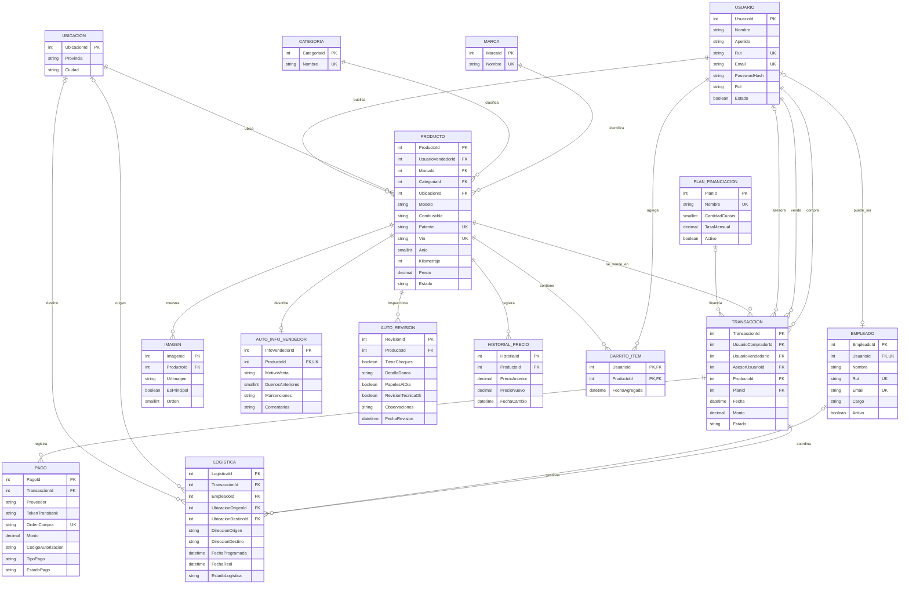

# Modelo relacional objetivo

Diagrama ER del esquema definido en
[`database/05_schema_vehiculos_objetivo.sql`](../database/05_schema_vehiculos_objetivo.sql).
Cada transaccion representa la compra de un unico vehiculo.
`Ubicacion` agrupa ciudad y provincia; modelo y combustible son atributos de `Producto`.

## Cómo visualizarlo

- **VS Code:** abre este archivo y usa la vista previa de Markdown (`Ctrl+Shift+V`). Si Mermaid no se renderiza, instala la extensión **Markdown Preview Mermaid Support**.
- **GitHub:** abre este archivo en el repositorio; GitHub renderiza los bloques Mermaid en Markdown.
- **SQL Server Management Studio:** ejecuta primero el DDL en una base de datos y crea un diagrama desde **Database Diagrams**. Ese diagrama se genera en SSMS; no está guardado como imagen en este repositorio.

El diagrama es una vista de las relaciones y claves principales. Para ver todos los tipos, restricciones e índices, consulta el DDL enlazado arriba.
